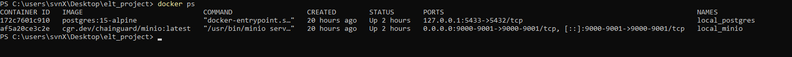
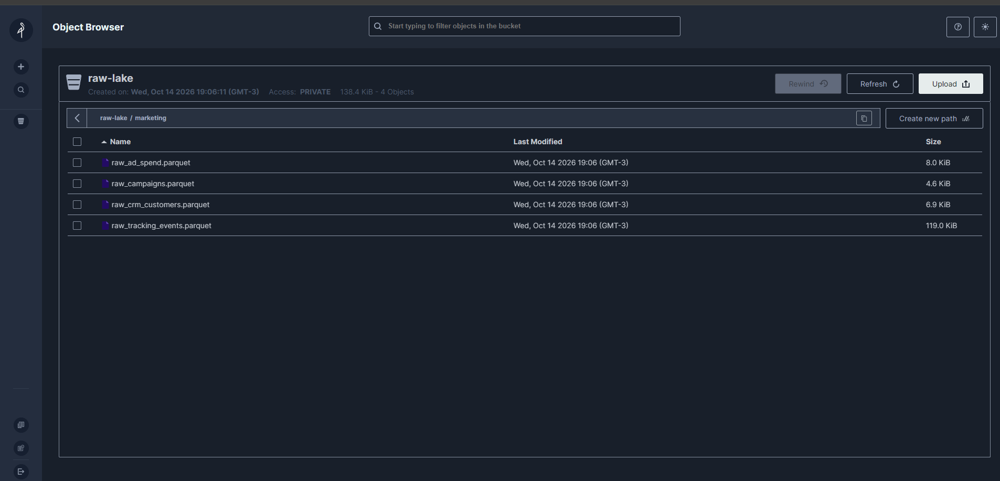
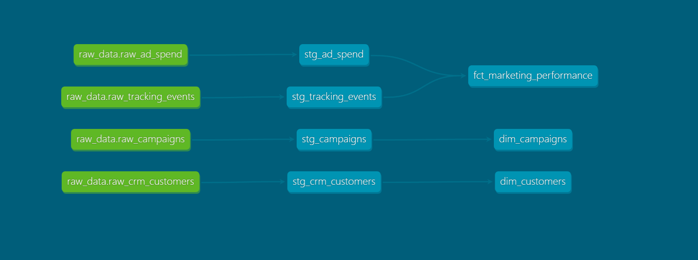
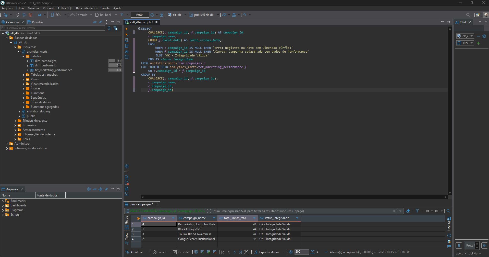

#  Projeto de Engenharia de Dados: Pipeline ELT Fictício

Este projeto demonstra a construção de um pipeline de dados completo (ELT) utilizando dados fictícios de negócios. O objetivo é simular um ambiente de produção moderno de Engenharia de Dados, cobrindo desde a geração dos dados brutos, armazenamento em Object Storage, carga em um Data Warehouse local e modelagem analítica para tomada de decisão.

---

##  Arquitetura do Projeto

O fluxo de dados foi desenhado seguindo práticas consolidadas de mercado:

1. **Geração de Dados (Python):** Scripts utilizam a biblioteca `Faker` para criar dados fictícios de negócios (ex: clientes, vendas).
2. **Data Lake (MinIO / S3):** Os dados brutos em formato parquet são ingeridos via Python e armazenados em um bucket do MinIO, simulando um ambiente AWS S3.
3. **Data Warehouse (PostgreSQL):** Os dados são extraídos do MinIO e carregados na camada de *Staging* do nosso banco de dados PostgreSQL.
4. **Transformação & Modelagem (dbt):** O dbt (Data Build Tool) se conecta ao Postgres para transformar e limpar os dados brutos, organizando-os em tabelas de *Dimensões* e *Fatos*.
5. **Visualização (Power BI):** Um dashboard interativo consome os dados modelados (via modo *Import*) para exibição de métricas gerenciais.

---

##  Tecnologias Utilizadas

* **Python 3.x & uv:** Utilizado o `uv` como gerenciador de pacotes ultrarrápido para gerenciar o ambiente virtual e as bibliotecas (`boto3`, `pandas`, `faker`, `python-dotenv`, `psycopg2-binary`).
* **MinIO:** Armazenamento de objetos (Object Storage) local compatível com a API do AWS S3.
* **PostgreSQL:** Banco de dados relacional atuando como o nosso Data Warehouse local.
* **dbt (Data Build Tool):** Responsável pela transformação de dados via SQL, testes de qualidade e documentação.
* **Docker & Docker Compose:** Orquestração automatizada de toda a infraestrutura local em contêineres isolados.
* **Power BI:** Ferramenta de Business Intelligence para a camada de visualização.

---

##  Portas e Variáveis de Ambiente

O projeto utiliza um arquivo `.env` dinâmico integrado ao Docker Compose. Para reproduzir o projeto, os seguintes padrões locais são aplicados:
* **MinIO API Endpoint:** `http://localhost:9000` (Chaves padrão: `minioadmin`)
* **PostgreSQL Local Host:** `localhost:5433` (Mapeado externamente para evitar conflitos de portas na máquina host)

---

##  Demonstração e Resultados (Portfólio)

### 1. Infraestrutura Rodando no Docker


### 2. Data Lake (MinIO Storage)


### 3. Linhagem de Dados (dbt Docs)
>  **[CLIQUE AQUI PARA ACESSAR O DBT DOCS ONLINE](https://salomaovalentim.github.io/marketing-elt-pipeline/)**  


### 4. CONSULTAS (SQL) 


---

## 🚀 Como Executar o Projeto Localmente

### Pré-requisitos
* Ter o **Docker** e o **Docker Compose** instalados.
* Ter o gerenciador **`uv`** instalado no Python.

### Passo 1: Clonar o Repositório
```bash
git clone https://github.com
cd elt_project
```

### Passo 2: Configurar o Arquivo de Ambiente
Copie o modelo do arquivo de exemplo para criar o seu arquivo `.env` privado:
```bash
cp .env.example .env
```
*(Os valores padrão já estão configurados no exemplo para rodar o ambiente fictício local imediatamente).*

### Passo 3: Subir a Infraestrutura (Docker)
Inicie o banco de dados e o bucket local em segundo plano com o comando:
```bash
docker compose up -d
```

### Passo 4: Instalar Dependências e Testar Conexões
Use o `uv` para sincronizar o ambiente virtual e rodar o script de validação de conectividade:
```bash
uv add psycopg2-binary boto3 python-dotenv pandas faker
uv run python src/elt_project/test_connections.py
```

### Passo 5: Geração de Dados e Carga (ETL)
Execute o pipeline para criar os dados fictícios e carregá-los nas ferramentas:
```bash
uv run python src/elt_project/generate_data.py
uv run python src/elt_project/pipeline.py
```

### Passo 6: Rodar as Transformações (dbt)
Navegue até a pasta do dbt e execute os modelos de dados:
```bash
cd dbt_project
dbt run --profiles-dir .
```

---
Desenvolvido por Salomão Valentim (www.linkedin.com/in/salomaovalentimdata)
